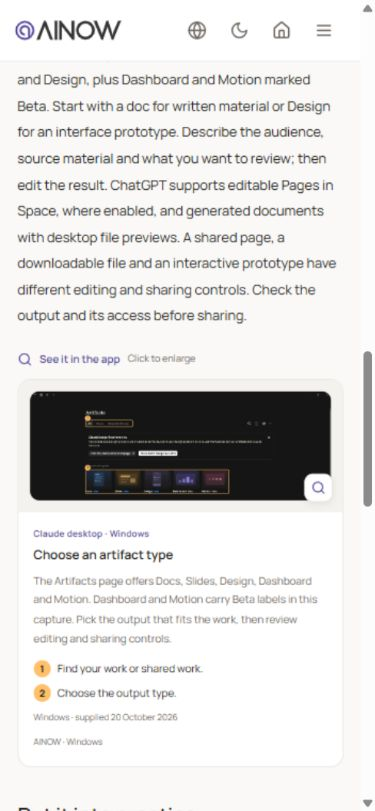

# Guide, Help and Settings polish — 24 October 2026

Local candidate **v0.95-rc34**. This follow-up preserves the existing branding and component ownership from the [shared UI contract](../design-system/README.md). It extends the [rc33 whole-app review](../final-audit/README.md); it does not replace its historical evidence or claim a new physical-device audit.

## Findings and repairs

1. **Decorative callout rails and oversized screenshot previews.** Removed the accent left rails from DEV notes/setup blocks and the extra left rule from chapter section selection. Screenshots keep their original assets and annotations, use their intrinsic proportions, and clip to a shared 10px corner radius. The supplied Claude Artifacts preview is now about 261px high at its 678px desktop width, previously 424px. Fit/actual-size viewing, close and opener focus restoration remain functional. Mobile previews fit at 320px and 390px.
2. **Help was lengthy to navigate.** Added simple on-page shortcuts to the workspace guides, task steps and FAQs. They focus the target heading without replacing the route. Step markers and worked examples use the shared palette and radii. FAQ answers still explain the task on the page, and only one answer expands at a time. Corrected EN/MK/SQ answers that referred to the removed Offline ready label or implied Education stored learning work.
3. **Settings feedback was far from the action.** Preference save/error feedback now appears immediately after the preference controls; restored/reset feedback belongs to Data & backups. Language and appearance have matching explanatory rows and 44px selects. At narrower desktop widths, controls move below their labels before the 240px sidebar makes them cramped. Workspace selection updates its URL parameter and preserves other URL parts. Restored language/theme refresh without overwriting the restoration message. Export/restore retain their shared row styles and isolated formats; reset stays secondary.
4. **A legacy dark sidebar colour competed with shared tokens.** Removed the old Tailwind background/border colour classes from the actual shared SidebarWrapper. Root pages and all React workspaces now use `--ui-inset` and `--ui-line`, matching the common warm palette.

## Verification

| Check | Result |
| --- | --- |
| Complete checkout regression suite | **106 passed, 0 failed** in [tests.tap](tests.tap), including four new behavioral checks for preference failures, workspace URL/isolation, restored feedback and translated Help shortcuts. |
| Portable source archive suite | **94 passed, 0 failed**; see [source verification](source-verification.json). |
| Responsive language/theme matrix | **132 observations**, no horizontal overflow, missing headings or sampled raw translation keys. [browser-matrix.json](browser-matrix.json): Settings in EN/MK/SQ × light/dark × 320/390/767/768/1024/1280px; Help overview and all three workspace guides in EN/MK/SQ × light/dark × 320/390/768/1280px. |
| Actual interactions | [behavior-checks.json](behavior-checks.json): mobile heading focus, exclusive FAQ, invalid backup rejection with cleared file input, 767/768px menu boundary and mobile guide image geometry. Screenshot viewer fit/actual-size, closing and opener focus were checked. Preferences restored to English/light after QA. |
| Origin unavailable | [offline-checks.json](offline-checks.json): updated rc34 Help/Settings rendered while the loopback port was confirmed unavailable. The preview was restarted afterward. |
| Source/content | DEV sync passed for 2,226 records, 1,000 original skill files and 14 Windows captures. [static-checks.json](static-checks.json): 10 entry documents, 60 linked JS files, 24 inline scripts, four JSON-LD blocks and 287 assets. All public JavaScript also parses in the release suite. |
| Isolation | [isolation.json](isolation.json): 4,103 baseline files compared; exactly the same 14 inherited native differences. All 1,068 protected content, vendor and brand files match rc33. No native/prototype/source-project writes. |
| Archives | rc34 runtime and corresponding-source ZIPs are CRC checked, matched to source, and reproduced twice. [Package verification](package-verification.json); SHA256 values are also in `dist/AINOW-Literacy-web-v0.95-rc34-checksums.json`. |

No real saved work was restored or reset. Invalid backup handling used the disposable [fixture](invalid-backup.json). Reset/restore isolation and failure paths use in-memory automated tests. There was no external AI request, deployment, commit, tag or publication.

## Capture review

Captures were reopened and inspected from disk. Images 01–02 are the before views. Images 03–08 preserve intermediate styling before the sidebar palette cleanup. Image 09 caught a stale resize/transition frame, and 11 caught an unpainted frame; both are excluded from acceptance. Their replacements are 10 and 12. All captures use viewport emulation; they are not physical-phone evidence.

Final proof: [Help desktop/light](14-help-en-light-desktop.jpg), [Settings backup actions/keyboard focus](15-settings-data-en-light-desktop.jpg), [Settings SQ/dark at 390px](10-settings-sq-dark-390-stable.jpg), [DEV Help SQ/dark at 320px](12-help-dev-sq-dark-320-stable.jpg), [invalid-backup feedback at 320px](13-settings-backup-invalid-320.jpg), and [rounded guide screenshot at 390px](16-guide-rounded-en-light-390.jpg).

Real-phone, screen-reader, cross-browser and final-hosting/cache-migration sign-off remain pending. The checks above establish these local flows and sampled layouts, not universal accessibility or device certification.
